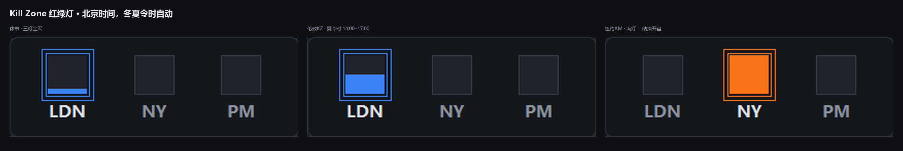
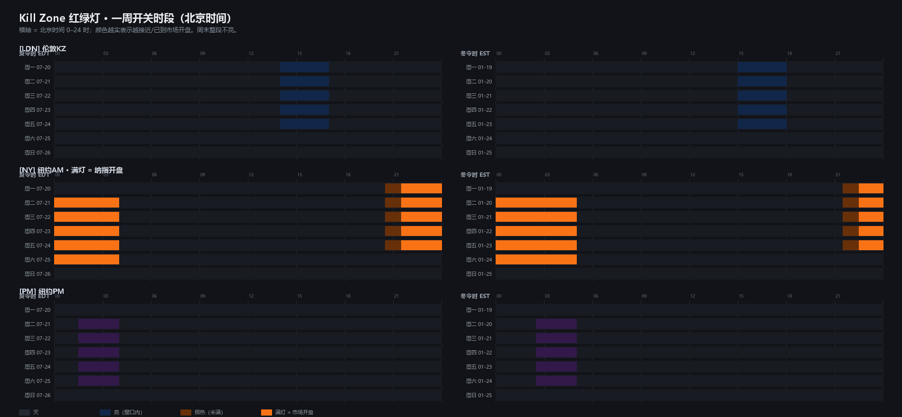

# Kill Zone Traffic Light

**English** · [简体中文](README.zh-CN.md)

[](https://github.com/ceciliaswang98-coder/killzone-traffic-light/actions/workflows/selftest.yml)
[](https://www.python.org/)
[](#requirements)
[](#requirements)
[](LICENSE)

Three small lamps pinned to the corner of your desktop, showing **ICT Kill Zones in Beijing time
(UTC+8)** — with **daylight saving handled automatically**.



- `LDN` London KZ · `NY` New York AM · `PM` New York PM (no Asia session)
- A lit lamp means you are inside that Kill Zone; the square fills up from the bottom as the window progresses
- **`NY` full = the Nasdaq is open** — a lit-but-not-full lamp does *not* mean the Nasdaq is open
- Dark on weekends (forex trading week)
- Drag to any corner, collapse to the system tray, tray icon mirrors the state
- **Zero third-party dependencies** — standard library only (tkinter + zoneinfo + ctypes)

---

## Why not just hardcode the times

Most Kill Zone tables published online are given in **UTC**, but ICT defines them in
**New York local time (ET)**. The widely quoted "Asia 01:00–05:00 UTC / London 07:00–10:00 UTC"
is the **winter (EST)** conversion — in summer everything shifts by one hour.

There is a subtler trap as well. **The US and the EU switch DST on different dates**
(2026: US on Mar 8 and Nov 1; EU on Mar 29 and Oct 25). During those two or three
"mismatch weeks" the London–New York gap is 4 hours instead of 5, so any table built on
fixed UTC or on London time is off by an hour exactly when it matters.

This project uses **ET as the single source of truth** and derives everything else from the
IANA tzdata database, so it stays correct on every date.

---

## Requirements

- Windows, Python 3.9+
- `tkinter` (bundled with the python.org installer)
- `tzdata` on Windows — `pip install tzdata` if `zoneinfo` cannot find a timezone

Nothing else. No `pip install` of the project itself.

## Running

```bat
:: run it
python killzone_light.py

:: preview any moment (debugging)
python killzone_light.py --at "2026-07-15 22:00"

:: start with the settings window already open
python killzone_light.py --settings
```

To keep it on your desktop, create a shortcut pointing at `pythonw.exe`:

```
Target : C:\...\pythonw.exe
Args   : -B "C:\...\killzone_light.py"
```

`-B` stops Python from writing a `__pycache__` directory next to the script.

---

## Usage

| Action | Effect |
|---|---|
| Left-drag | Move it; it snaps to the nearest screen corner on release |
| Double-click | Collapse to the system tray |
| Mouse wheel | Adjust opacity (saved immediately) |
| Right-click | Open the settings window |
| Tray icon, left-click | Show / hide the widget |
| Tray icon, right-click | Open the settings window at the cursor |
| Tray tooltip | e.g. `NY 0:59 left` or `next LDN 14:00 (in 1:48)` |

The settings window uses plain Tk controls; every change applies and is persisted to
`config.json` right away.

---

## Verified schedule

The table below is *computed* by `killzones.py` from the IANA tzdata database — it is not
transcribed from a blog post.

| Lamp | Kill Zone | New York (ET) | Beijing · DST | Beijing · standard | Length |
|---|---|---|---|---|---|
| **`LDN`** | London KZ | 02:00 – 05:00 | **14:00 – 17:00** | **15:00 – 18:00** | 3h |
| **`NY`** | New York AM | 08:30 – 11:00 | **20:30 – 23:00** | **21:30 – 00:00⁺¹** | 2.5h |
| **`PM`** | New York PM | 13:30 – 16:00 | **01:30 – 04:00** | **02:30 – 05:00** | 2.5h |

Silver Bullet windows (1 hour each, ET `03 / 10 / 14`):
Beijing `15–16 / 22–23 / 02–03` under DST, `16–17 / 23–00 / 03–04` under standard time.

### Weekly on/off schedule



`LDN` and `PM` fill **linearly** across their window: 0% when it opens, 100% when it closes.

`NY` is a **two-stage** lamp, so you can tell "warm-up" from "Nasdaq open":

| Stage | Beijing · DST | Beijing · standard |
|---|---|---|
| Warm-up (lit, not full) | 20:30 – 21:30 | 21:30 – 22:30 |
| **Full = Nasdaq open** | 21:30 – 04:00⁺¹ | 22:30 – 05:00⁺¹ |

> The US cash session runs 09:30–16:00 ET **continuously with no lunch break**, so the full
> lamp should have no gap in the middle.

### Dark on weekends

The trading week follows forex: **Sunday 17:00 ET opens → Friday 17:00 ET closes**.

| | Opens | Closes |
|---|---|---|
| DST | Monday 05:00 Beijing | Saturday 05:00 Beijing |
| Standard | Monday 06:00 Beijing | Saturday 06:00 Beijing |

One easy thing to misread: **early Saturday morning (Beijing 00:00–04:00) is lit** — that is
Friday afternoon in New York. Everything goes dark after 05:00 Beijing on Saturday.

Regenerate the weekly chart with `python schedule.py`.

---

## Customization

### Change the Kill Zone times

Edit `KILLZONES` in `killzones.py`:

```python
KILLZONES = (
    KillZone("london", "伦敦KZ", "#3B82F6", (2, 0),  (5, 0),  "外汇最强 · EUR/GBP 主战场"),
    KillZone("nyam",   "纽约AM", "#F97316", (8, 30), (11, 0), "黄金 / 纳指 参考窗口",
             market_open=(9, 30), market_close=(16, 0), market_label="纳指"),
    KillZone("nypm",   "纽约PM", "#A855F7", (13, 30), (16, 0),"尾盘调仓 · 顺势为主"),
)
```

All times are **New York local time** — never UTC, never Beijing. The conversion is done for you.

`market_open` / `market_close` are optional. Supply them and the lamp becomes **two-stage**
(fill from `start` → reach full at `market_open` → stay full until `market_close`).
Leave them out and the lamp simply fills linearly across the Kill Zone window.

### Change the short labels / layout

Short labels live in the `SHORT` dict at the top of `killzones.py`. Switch between the
horizontal (abbreviated) and vertical (full-name) layout in the settings window.

### Change the icons

```bat
python make_logo.py
```

Generates `logo.ico` (desktop shortcut) plus `icon_idle.ico` / `icon_active.ico`
(the two tray states). Change the palette via `LIGHTS` in that script.

---

## Files

| File | Purpose |
|---|---|
| `killzone_light.py` | Main widget (tkinter + tray, DPI scaling, single-instance guard) |
| `killzones.py` | Kill Zone time engine: ET → Beijing, DST handled by tzdata |
| `tray.py` | Windows tray icon in pure ctypes (own thread + queue) |
| `logo.ico` / `icon_idle.ico` / `icon_active.ico` | Icons |
| `make_logo.py` | Generates the three icons above |
| `schedule.py` | Generates the weekly on/off chart |
| `selftest.py` | One-shot self-test |
| `screenshot.png` / `schedule.png` | Documentation images |

`config.json` is created at first run and stores position, layout, opacity and visible lamps.

---

## Self-test

```bat
python selftest.py
```

> CI runs the time-engine half only (`python selftest.py --engine-only`), because the tray and
> window tests need a real desktop session that GitHub runners do not have.
> See [`.github/workflows/selftest.yml`](.github/workflows/selftest.yml).

Three parts:

1. **Time engine** — Beijing conversions under DST and standard time, US/EU mismatch weeks,
   around the DST switch dates, lamp boundaries (1s before / at the instant / 1s before end /
   at close), fill progress, which trading day a window belongs to, the two-stage lamp,
   and the weekend rule.
2. **Tray** — message window, icon loading, `Shell_NotifyIconW(NIM_ADD)`, icon swap,
   balloon notification, `NIM_DELETE`.
3. **Widget** — launch, size, bottom-right margins, opacity actually applied from config,
   settings window opens without corrupting config, clean exit.

---

## Implementation notes (things that bit me)

- **No native popup menu.** `tk.Menu.tk_popup` is unreliable on a frameless, always-on-top,
  translucent window — it once rendered as a blank grey box with no items drawn at all.
  Replaced with a separate settings window using plain Tk widgets.
- **`tk.Scale` fires its `command` once at creation**, which silently overwrote the stored
  opacity. The fix is: create the widget → set the initial value → *then* attach the callback.
- **Read `config.json` with `utf-8-sig`.** A BOM (written by an editor or PowerShell) makes
  `json.loads` raise; if that is swallowed by a bare `except`, the app silently falls back to
  defaults and it looks like your settings were never saved.
- **Shortcut icons must live in the user profile.** Explorer extracts `.lnk` icons in a
  restricted low-integrity process that cannot read some directories (e.g. a working folder
  with unusual ACLs), and the icon degrades to a blank page.
  `make_logo.py` writes a copy to `%LOCALAPPDATA%\KillZoneLight\`.
- **Smart App Control.** When enabled it blocks `.bat` / `.vbs` / `.ps1` and `.lnk` files
  created outside system-managed locations, with
  `Dangerous file extension from the web`. So the launcher points straight at the signed
  `pythonw.exe` and the project ships no scripts at all.
- **DPI.** The app is DPI-aware and scales every dimension, so it looks the same and stays
  sharp at 100% / 125% / 200%.
- **Performance.** The main loop ticks every 400 ms but only redraws when the render
  fingerprint actually changes.
- **The horizontal padding is deliberately asymmetric.** The labels are drawn with
  `anchor="n"`, leaving a descent gap under the glyphs, so `pad_bottom` has to be smaller
  than `pad_top` or the content looks like it sits too high.

---

## License

MIT — see [LICENSE](LICENSE).
